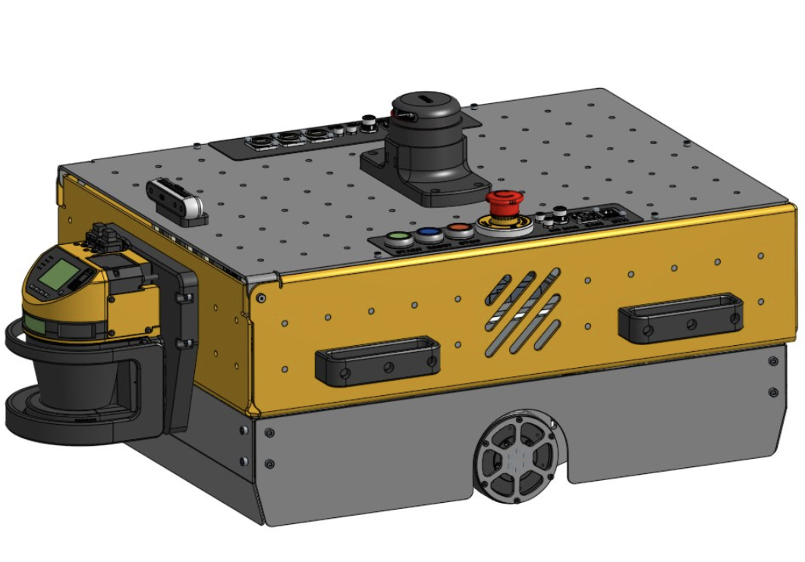
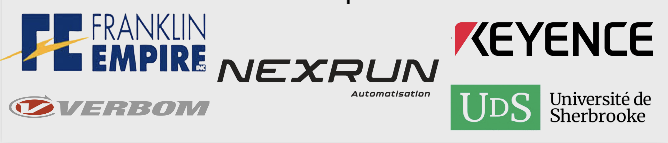

# Minos  

Une plateforme AMR (**A**utonomous **M**obile **R**obot) éducative conçue pour être entièrement personnalisable, elle offre au corps professoral la possibilité de modifier sa configuration au gré des objectifs d'apprentissage de leurs cours.

    ** TODO mettre le vidéo de mégagénial **
    

# Structure du répertoire

    ** TODO changer quand la migration vers ce repo va être fait **

# L'équipe

- Loïc Legault
- Samuel Langevin
- Thomas Giroux
- Thomas Maher
- Simon Lamontagne
- Samuel Langevin
- Simon Gariépy
- Xavier Bourget

# Nos partenaires

  

